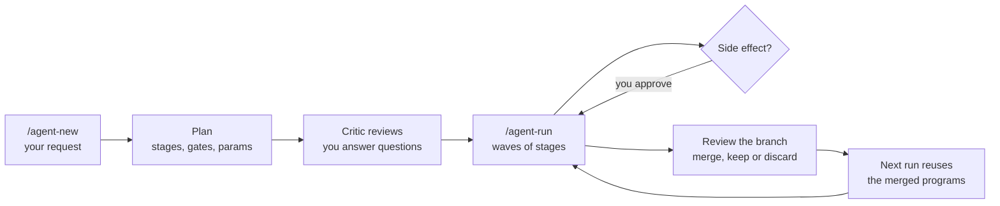

# How prometheus works

You probably have a job like this one. Once a month, someone hands you a folder of emails, and you copy the sender, the date, the subject and the body into a spreadsheet. It isn't hard, but it is tedious, and it never quite goes away.

You could ask a model to do it each month. That works, but every month it starts from scratch: it reads every email afresh, works out again how to parse them, and lays out the spreadsheet slightly differently from last time. You pay for the same thinking over and over, and you check the result over and over.

prometheus is built for jobs like that. You describe the job once, and it turns your description into an **agent**: a folder that is a Pi agent of its own, holding a plan for the job and carrying it out. The first time the agent runs, it writes small programs for the mechanical parts, and you look them over. From then on those programs do the routine work in a fraction of a second, a model is called only for the parts that genuinely need judgment, and nothing with real consequences happens until you've said yes.

On this page we'll follow one real agent, `emails-to-excel`, from the one-line request that created it to its second run. Everything shown in a code block was copied from its actual runs, so what you see is what you'll get.

## The short version

It all starts with a single command:

```text
/agent-new I want to read the emails in a folder and save them in an Excel file
```

prometheus asks you a few questions, and when it's done, your request has become a folder:

```text
~/agents/emails-to-excel/
  plan.yaml       the plan: what it does, in sections
  gates/          programs that check what a stage produced
  scripts/        stage programs: the work itself, as plain code
  .pi/            the agent itself: extension, subagents, skill copy
  .env            this machine's values (not in git)
  runs/           one folder per run (not in git)
```

You run that folder whenever the job comes round again. Here's what that looked like for emails-to-excel: a run where models did everything, one where the reviewed programs did the routine work, and one on emails the agent had already seen:

| | Every stage done by a model | Programs run as commands | The same emails again |
| --- | --- | --- | --- |
| Model cost | $0.016 | $0.004 | $0 |
| Whole run | under 4 minutes | 77 seconds | 29 seconds |

The run where the models also wrote the programs cost a little more, $0.021. That's the first run in the [tutorial](tutorial.md#8-run-it-again), and [the second run](#the-second-run-where-it-pays-off) explains why it pays for itself.

The diagram below shows the whole cycle. Don't worry if some of the boxes don't mean much yet; we'll go through each one in turn.



## Two agents, two jobs

The first thing to know is that you'll be talking to two different agents, and each one has a single job. You start them with the same command:

```text
$ prometheus                                $ prometheus emails-to-excel
> /agent-new <request>                      > /agent-run
```

**prometheus**, on the left, is the planner. It works out how the job should be done, writes that down as a plan, and then steps back. It never reads your emails or touches your spreadsheet. It's also careful about when it starts: only `/agent-new` sets it planning. If you just describe a job in conversation, it will talk it through with you, but it won't build anything.

> [!NOTE]
> We learned that one the hard way. An early version took a passing remark, "I want to create documentation with docs in md", as a request, and cheerfully built an agent nobody had asked for.

**The agent**, on the right, is the one that gets the work done. It hands the actual tasks to subagents through [pi-subagents](https://github.com/nicobailon/pi-subagents) and keeps you informed as they finish. It doesn't have to remember the rules about what's allowed when, either: a set of Python scripts keeps track of that, and the agent simply follows their lead.

Once an agent exists, it no longer needs prometheus at all. The folder carries everything it needs, so you can copy it to another machine with `/agent-export` and run it there.

## Planning

### The plan

Everything the agent does lives in one file, `plan.yaml`, in sections: what you asked for, what it works on, how it works, the assumptions it makes, and its limits. It starts with your request in your own words, followed by the goal and a list of what "done" means, written so you can check each line yourself:

```yaml
request: I want to read emails and save them in Excel
goal: >-
  Read the selected emails and save their requested information in an Excel workbook.
done_when:
  - The selected emails are processed according to the user's chosen scope and fields.
  - An .xlsx workbook is saved at the configured output path.
  - The workbook contains one row per email and its columns match the confirmed extraction scope.
```

Those `done_when` lines matter: at the end of every run, the agent goes through them one by one and tells you which were met, and how it knows.

Notice that the plan describes the job, not any particular occasion of doing it. There's no "March" in it, and no folder path. That's deliberate, and it's what lets the same plan run next month on next month's emails.

### Stages, and who does each one

A plan breaks the job into **stages**. Emails-to-excel has three, and they're worth a close look, because each one is done in a different way:

```text
discover         judgment        a model reads sample emails and reports the formats and fields
read-emails      deterministic   a program extracts the fields; a gate checks every file is accounted for
build-workbook   side_effect     a program writes the .xlsx; you approve it first
```

The middle column is the stage's **kind**, and it's the most important thing about a stage, because it decides who does the work and how carefully it's watched:

| Kind | What it means | Who does it |
| --- | --- | --- |
| `side_effect` | it changes something outside the run | an agent, but only after you approve it, every single time |
| `decision` | it's a choice that belongs to you | you, before that part of the run starts |
| `deterministic` | a program can get it right | a stage program, checked by a gate |
| `judgment` | it needs someone to read and think | a model, often checked by a second model |

When prometheus classifies a stage, it asks these questions in that order and stops at the first "yes". So a stage that writes to your CRM counts as a side effect even if the work itself is entirely mechanical. The first question is always "can this be undone?", and only after that, "who's best placed to do it?".

> [!TIP]
> Real work is rarely all one kind. Often most of it is mechanical, with a few awkward cases at the end. prometheus splits that into two stages: a program handles the regular cases and writes the awkward ones to a file, and a small judgment stage looks at just those. That way a model spends its time on the handful of odd emails rather than every ordinary one.

### Stage programs and gates

This is where the savings come from. A deterministic stage is simply a program and the arguments to run it with:

```yaml
- id: read-emails
  kind:
    value: deterministic
    reason: the fields are in fixed headers
  pattern: script
  program:
    file: read_emails.py
    args: "${email_folder} discovery.md email-rows.json unparsed-emails.json"
```

The first time the agent runs, a model writes `read_emails.py`. You review it along with everything else the run produced, and from then on the agent just runs it, which takes about a tenth of a second. Here's one row of what it extracted from the tutorial's sample emails:

```json
{
  "file": "01-status.eml",
  "from": "Ada Lovelace <ada@example.test>",
  "to": "team@example.test",
  "cc": "",
  "date": "Wed, 02 Sep 2026 10:00:00 +0000",
  "subject": "Weekly status",
  "body": "Hi all,\n\nDeploy is done. Next: invoice export.\n\nAda\n"
}
```

Of course, a program that runs without anyone watching needs checking, and that's the job of a **gate**. For `read-emails`, the gate makes sure every `.eml` file in the folder ended up either as a row like the one above or in `unparsed-emails.json` with a reason. Nothing slips through silently.

Gates are written while the plan is being made, before the stage has ever run, and never by the stage they check. It's the same reason you wouldn't let someone mark their own exam.

> [!NOTE]
> If a program does fail one day, perhaps because an email arrives in a format it has never seen, the agent doesn't just retry. It calls a model, shows it the exact error, and asks it to fix the program, so the fix is there for every run after.

### Params: values that belong to your machine

An agent should run anywhere, so the plan never contains anything specific to one computer. The input folder, an output path, a database table, an API token: each of these is a **param**. The plan says the param exists and what it's for, and its actual value lives in a file called `.env` next to the plan:

```yaml
params:
  email_folder:
    description: Folder containing the user's exported .eml email files
    required: true
  output_file:
    description: Where to save the completed Excel workbook
    default: outputs/emails.xlsx
```

```sh
# .env: this machine's values, never committed
EMAIL_FOLDER='/Users/me/Mail/export'
```

You'll notice that planning never asks where your emails are. That's not an oversight: the answer depends on whose machine the agent is running on, so `/agent-run` asks instead, when it actually needs to know.

> [!IMPORTANT]
> Secrets get extra care. The model can't read `.env` at all, so a token's value never appears in a chat, a log or a task. When a secret is missing, the agent tells you the name of the variable to set and waits for you. The details are in [Params, `.env` and secrets](params-and-secrets.md).

### When you can't know everything up front

Here's an honest problem with planning: when emails-to-excel was planned, nobody had seen the emails yet. Would they be plain text or HTML? Would they have attachments? A planner that had to write down every detail anyway would simply make things up, and made-up detail is worse than none.

So instead, the plan begins with a **discovery stage**. `discover` is a model whose only job is to look at a sample of the real input and report back. The stages that depend on what it finds are left as **provisional** outlines until it has. On emails-to-excel's first run, `discover` read eight sample messages and found quite a mix:

- plain text, and HTML only
- multipart with an attachment
- non-ASCII headers
- a reply and a newsletter
- an empty subject

The run then paused to **resolve**: it wrote the details of `read-emails`, and its gate, from what `discover` had actually seen.

### A second pair of eyes

Before any plan can run, a second agent, the **plan critic**, reads it through. We do this because a model checking its own work tends to miss exactly the things it missed while writing it. The critic starts fresh, sees only the plan file and none of the planner's reasoning, and asks the awkward questions: does the goal really match what you asked for? Is each stage the right kind? Is anything with a side effect hiding where it shouldn't be?

It earns its keep. When emails-to-excel's stages were given their programs, the critic noticed that `build-workbook` named a program but was still set up for a model to do the work by hand. The planner fixed it, and the critic's second pass approved the change.

The planner has to answer every finding the critic raises, either by accepting it, by rejecting it with a reason, or by turning it into a question for you.

### The questions you'll be asked

You might expect a planner to start by quizzing you. prometheus does the opposite. It drafts the plan first, lets the critic review it, and only then asks you anything, because by that point it knows which answers would actually change the plan. It asks only where a wrong guess would change the stages, a side effect, where data comes from or goes to, or what counts as done, and it keeps it short: at most three questions at a time, and two rounds.

## Running

With a plan in place, you start the agent (`prometheus emails-to-excel`) and type `/agent-run`. Here's what happens next.

### Waves

The agent doesn't launch the stages one at a time. It groups them into **waves**: as much work as it can hand off in one go before it needs to stop and check in with you. You never write waves yourself; they're worked out from the stages. For emails-to-excel there are two:

```json
"waves": [
  { "id": "w1", "stages": ["discover", "read-emails"], "ends_with": "none" },
  { "id": "w2", "stages": ["build-workbook"],          "ends_with": "approval" }
]
```

Each wave also records what the agent has to do once it's over (`ends_with`): nothing, resolving provisional stages, a review with you, or an approval.

When the first wave starts, the agent lets you know. From a real run:

> Run `2026-10-01-3` has started. Wave `w1` is reading and discovering the selected emails; it launched three children. I'll continue when the wave finishes.

The three **children** are the background agents doing the work: `discover`, a reviewer that double-checks `discover`'s report, and `read-emails`. Nothing between them needs you, so they run as one wave, and you're free to get on with something else.

`build-workbook` is different. It writes a file that you'll keep, so it gets a wave of its own, and the run stops to ask your permission before launching it. That permission isn't something the model can talk its way around: the code simply refuses to launch a side-effect stage you haven't approved.

> [!NOTE]
> One thing to keep in mind if you write plans by hand: only files carry over from one wave to the next. If a later stage needs something, an earlier stage has to write it down.

Between waves, the agent's own model does little more than compile the next wave, launch it and record how it went. `/agent-auto` does those steps in code instead, and wakes the model only when a wave needs you or something went wrong. Each wave then shows as two lines in the chat: one when it starts, and one when it ends, with how long it took and what it cost.

### Every run gets its own folder

Each run lives in its own folder, so one run can never overwrite another's results:

```text
runs/2026-10-01-3/
  run.yaml        what happened
  work/           the children's working files
  outputs/        the results: here, emails.xlsx
  .compiled/      each wave as launched
```

`run.yaml` is the run's memory, and it's what makes it safe to walk away. Close Pi halfway through, come back tomorrow, type `/agent-run`, and it picks up exactly where it left off. Here's part of it after a finished run:

```yaml
id: 2026-10-01-3
status: done
revision: 4
stages:
  discover: done
  read-emails: done
  build-workbook: done
launches:
  - wave: w1
    stages: [discover, read-emails]
    status: done
    params:
      email_folder: /Users/musaparmaksiz/projects/prometheus/scratch/emails
      output_file: outputs/emails.xlsx
    cost_usd: 0.00377
```

Because each launch records which revision of the plan it used, you can always see exactly what ran: `git show r4:plan.yaml`.

### When something goes wrong

Sooner or later a wave will fail. A gate might reject an output, a reviewer might find a serious problem, or the wave might not start at all. When that happens, the agent tells you plainly what went wrong and asks what you'd like to do: try the wave again, change the plan, or stop the run.

> [!TIP]
> Trying again doesn't mean starting over. Any child that already finished, and whose inputs haven't changed, is skipped.

### Changing the plan mid-run

Sometimes, as with `discover`, a run learns something that changes the plan. When that happens it **resolves** the stages that haven't run yet: it writes them out from what it learned. Resolving is deliberately limited, though. It can't touch your request, the goal, what counts as done, the params, the inputs, the outputs or the agents, and it can never quietly turn a side effect into something that no longer needs your approval. If you want a bigger change, that waits until the run is over, and you make it with `/agent-revise`.

## Reviewing what a run changed

By now the first run has done more than produce a spreadsheet. It has written two programs and filled in part of the plan. That raises a fair question: should next month's run just start using all that?

Our answer is: not until you've had a look. Each agent is its own git repository, and its `main` branch holds only what you've reviewed. Anything new waits on a branch of its own:

| Branch | Opened by | Holds |
| --- | --- | --- |
| `run/<id>` | a run's first commit | its resolves and the programs it wrote |
| `revise/<date>-<n>` | `/agent-revise` | a change you asked for |
| `improve/<date>-<n>` | `/agent-improve` | fixes drawn from earlier runs |

When a run or a change finishes, the agent walks you through what's on the branch and asks what you'd like to do with it:

- **merge** it, and it becomes one commit on `main`, tagged with the plan's revision (`r2`, `r3`, and so on). Every run from then on uses it. A change that leaves the plan itself alone, such as a fixed program or a new lesson, keeps the revision number, and the tag simply moves to the new commit.
- **keep** it for later, and you go back to `main` with the branch still there.
- **discard** it, and it's gone.

And if a run didn't change anything, there's nothing to review, so it won't ask.

## The second run: where it pays off

This is the moment the whole design is built around. Here are emails-to-excel's real runs, side by side:

| Run | What happened | Model cost | Whole run |
| --- | --- | --- | --- |
| 2 | every stage done by a model | $0.016 | under 4 min |
| 3 | the models also wrote the two programs, once | $0.021 | |
| 4 | the programs reused, but run by a model | $0.0105 | about 2.5 min |
| later | the programs run as plain commands | $0.004 | 77 s |
| later, same emails | `discover` too: its report is reused from the last run | $0 | 29 s |

The model cost is the subagents'. The agent's own model, which asks the questions, compiles and records each wave and reports, adds about $0.02 a run on top; the web app shows both.

You'll notice run 3 actually cost more than run 2. That's the investment. Writing a program that can be reused (214 and 129 lines here, taking arguments rather than fixed paths) is more work than doing the job once. But you only pay for it once. After that, each program takes a tenth of a second where a model used to take fifteen or twenty, and the only stage still using a model is `discover`.

Even `discover` runs only when the emails change. Its output depends only on its instructions and on what it reads, so when both match a run that already finished it, the agent copies that run's outputs instead of launching it again. The same goes for any model stage without a side effect, and the compiler's notes tell you which stages were reused.

> [!TIP]
> Once your emails always arrive in the same format, new emails needn't run `discover` either: see [How to drop a discovery stage](how-to.md#how-to-drop-a-discovery-stage-once-the-input-is-stable).

Two other things affect what a run costs, if you're designing your own plans. The agent does its bookkeeping once per wave, so a plan with fewer waves is cheaper than one with fewer stages. And a `map` stage, which splits a large input into batches, launches one child per batch, so its cost grows with the size of the input.

## When the plan has settled: releases

So far you've run the agent by talking to it. Once its plan has settled, with no stage left to discover and every program written and reviewed, the agent can also run with nobody at the keyboard. You make a **release** of it with `prometheus release emails-to-excel`, which tags the current `main` as `v1.0`.

A release can then be run from the shell (`prometheus run emails-to-excel@v1`), from a Python program (`load_agent("emails-to-excel@v1")`), or as a small web service other programs and agents can call (`prometheus serve`). No model decides anything in such a run. Where the plan would ask a person, for an approval or a decision, the caller answers instead, either up front or when the run stops to ask.

The steps are in [How to run an agent from code](how-to.md#how-to-run-an-agent-from-code) and [How to serve an agent over HTTP](how-to.md#how-to-serve-an-agent-over-http). Why releases work the way they do is in [Design decisions](design.md#running-agents-from-code).

## Words used on this page

| Word | Means |
| --- | --- |
| **agent** | what prometheus builds: a folder `<slug>/` in the agents folder (`~/agents`, or `PROMETHEUS_AGENTS`) that is a Pi agent of its own, with a plan, its programs and gates |
| **plan** | `plan.yaml`: the job, what counts as done, and the stages |
| **stage** | one step of the work, such as "extract the fields from every email" |
| **kind** | whether a stage is a side effect, a decision, deterministic or judgment |
| **stage program** | the code that does a deterministic stage, in `scripts/` |
| **gate** | a program that checks a stage's output, written before the stage runs |
| **param** | a value that depends on the machine; it lives in `.env` |
| **run** | one execution of the plan, in its own folder `runs/<id>/` |
| **wave** | the stages launched together before the agent next needs you |
| **subagent** | a profile a stage runs as (`scout`, `reviewer`, `batcher`, or one the agent defines in `.pi/agents/`) |
| **child** | one subagent doing a stage, or part of one |
| **side effect** | a stage that changes something outside the run |
| **resolve** | filling in later stages during a run, from what discovery found |
| **branch** | where a run's or a change's edits wait for your review |
| **release** | a version of the agent that code can run with nobody deciding anything, tagged `v<major>.<minor>` |

## Where to go from here

- If you'd like to try all this yourself, the [tutorial](tutorial.md) walks you through this exact agent in about fifteen minutes.
- If you're curious why a rule is the way it is, [Design decisions](design.md) tells the story behind each one, including what went wrong first.
- If you're writing or editing plans, [`plan-schema.md`](../.pi/skills/agent/references/plan-schema.md) describes the format field by field.
