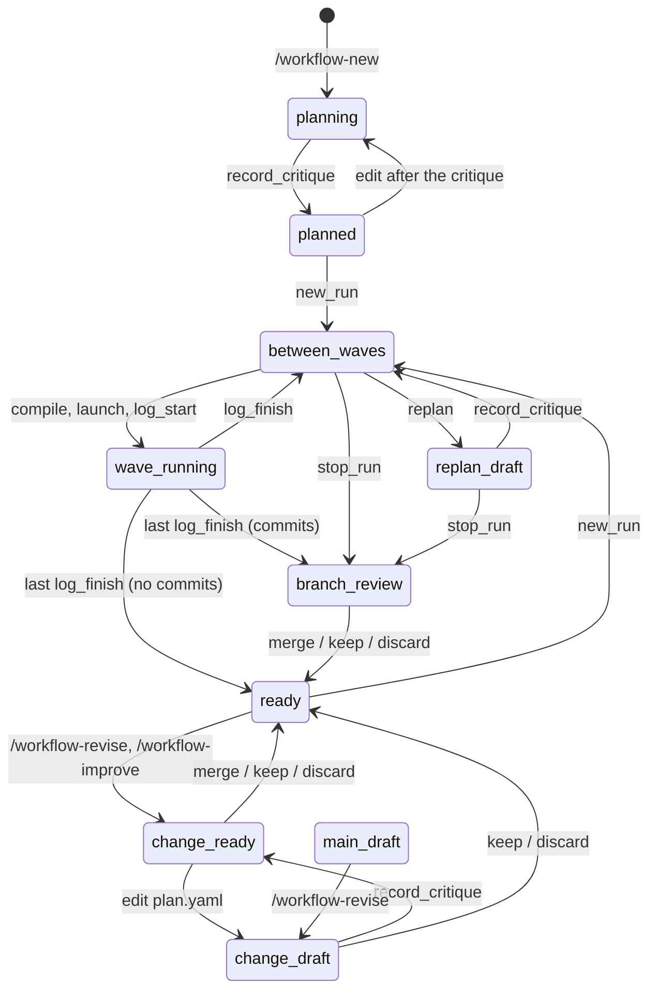

# Workflow state machine

This page is for contributors. It lists what a workflow can be doing (its **state**) and the moves between states, as the scripts enforce them. If you only run workflows, `/workflow-status` tells you the state you are in and what you can do next; you don't need this page.

A move the table doesn't list is refused by a script, except the few under "Allowed, outside the table". `workflow_state.py` computes the state and its legal moves (`MOVES`). Every workflow tool's result carries them as `next`, `workflow_check` returns them as `state`, and `/workflow-status` shows them. `tests/test_state_machine.py` walks every state and move with the real scripts and checks the rules below.

## What defines a state

Four facts, each read from one place:

| Fact | Values | Read from |
|---|---|---|
| plan status `P` | `draft`, `needs_answers`, `ready` | `plan.yaml` `status`; a `ready` plan edited after its critique was recorded counts as not ready (`critique.plan_digest`); on a branch, so does one that differs from `main`'s without a critique of it (`validate_plan.check_ready`) |
| active run | none, or one run with status `active` (at most one) | `runs/*/run.yaml` (`runs.active_run`) |
| wave running | some stage of the active run is `running` | `run.yaml` `stages` (set by `log_start`, cleared by `log_finish`) |
| branch `B` | `main`, `run/<id>`, `revise/<date>-<n>`, `improve/<date>-<n>` (older: `change/…`) | git (`workflow_git.branch`) |

One more, used by the extension's guard and by `begin-change`: whether the workflow has had a run yet (`runs/` has a `run.yaml`). Before the first run the plan is edited directly on `main`. `runs/` is not in git, so this fact is per machine: a fresh clone, or a deleted `runs/`, counts as "no run yet" and opens `main` to direct edits again.

## States

| State | Facts | What it means |
|---|---|---|
| `planning` | no run yet, `B` = main, `P` ≠ ready | the plan is a draft; edited directly |
| `planned` | no run yet, `B` = main, `P` = ready | the plan is ready for its first run; still open to direct edits |
| `ready` | runs exist, none active, `B` = main, `P` = ready | can start a run, or a change |
| `between_waves` | active run, nothing running, `P` = ready | the next wave is `summary.waves[0]`; `workflow_compile` may refuse with a preflight (decisions, approvals, params, secrets, provisional stages) |
| `wave_running` | active run, a stage `running` | a launch is in pi-subagents; nothing else may launch |
| `replan_draft` | active run, nothing running, `P` ≠ ready | `workflow_replan` ran; the critic must record before compile accepts the plan |
| `branch_review` | no active run, `B` = `run/…` | a run ended (done or stopped) and left a branch to review |
| `change_draft` | no active run, `B` = `revise/…`, `improve/…` or `change/…`, `P` ≠ ready | a change in progress |
| `change_ready` | no active run, `B` = `revise/…`, `improve/…` or `change/…`, `P` = ready | a change just opened (the plan untouched), or the critic passed; review next |
| `main_draft` | has runs, no active run, `B` = main, `P` ≠ ready | only in a workflow from before runs needed a ready plan (a run started from a draft, then stopped with nothing committed or its branch discarded); the exit is `/workflow-revise` |

Moves that stay in their state are left out of the diagram: `workflow_compile` while a preflight waits, `workflow_record_decision`, a second `workflow_replan`, a critique that makes a stopped run's draft replan mergeable in `branch_review`, and the read-only tools. `workflow_stop_run` goes to `ready` instead of `branch_review` when the run committed nothing. `main_draft` is reached only by workflows from before runs needed a ready plan.

The states are disjoint: a replan, a critique and a decision all wait for a running wave.

A run that ends with no commits has no branch, so it goes straight back to `ready`. A `run/…` branch whose plan is not ready (a run stopped after a replan) cannot be merged until the critic's result for that replan is recorded; until then it can be kept or discarded.

`ends_with` (`review`, `replan`, `approval`) is not a state: it is recorded at launch and tells the parent what to do after the wave. `approval` and `replan` are enforced by `compile` (side-effect stages need `--approve`; the preflight refuses provisional stages); `review` is not.

## Moves

| Move (tool or command) | From | To | Refused by (script) |
|---|---|---|---|
| `workflow_new_run` | `planned`, `ready` | `between_waves` | `run_log new`: an active run; a branch other than `main` checked out; `P` ≠ ready (`validate_plan.check_ready`). Before the first run it commits leftovers on `main` (planning); after it, on the run's branch |
| `workflow_compile` | `between_waves` | `between_waves` (writes `.compiled/`; commits the plan only when the wave can launch) | `compile_wave`: `P` ≠ ready (or edited after the critique), no active run, a wave running, no waves left, the wave already launched but not recorded, the last wave ended with a review and `reviewed` is not passed, preflight |
| `workflow_log_start` | `between_waves` | `wave_running` | `run_log start`: a wave running; the wave is not the next one; `P` ≠ ready (nothing compiled from a draft) |
| `workflow_log_finish` | `wave_running` | `between_waves` (wave done, or failed/blocked/stopped: its stages back to pending) | `run_log finish`: no running launch; pi-subagents still running (the refusal says whether its process is gone) or has no record, unless `result` and `status` are passed |
| last `workflow_log_finish` | `wave_running` | `branch_review`, or `ready` if nothing was committed | (same as above) |
| `workflow_record_decision` | `between_waves`, `replan_draft` | same | `run_log decision`: no active run; a wave running; not a decision stage |
| `workflow_replan` | `between_waves`, `replan_draft` | `replan_draft` | `plan_edit replan`: no active run; a wave running; locked keys; stages done; a side effect removed or weakened |
| `workflow_record_critique` | `replan_draft` | `between_waves` if the plan validates, else `replan_draft` | `plan_edit critique`: a wave running; no completed critic child with that run id in pi-subagents' records; more than 2 passes per replan |
| `workflow_record_critique` | `planning`, `planned` / `change_draft`, `change_ready` | `planned` / `change_ready` if the plan validates, else unchanged; on a change branch, a plan that differs from `main`'s at `main`'s revision gets the next one | (same, apart from the pass count); passes must be 1 or 2; on `main` once a run exists |
| `workflow_record_critique` | `branch_review` | `branch_review` (a draft replan becomes ready, so mergeable) | (same) |
| `workflow_stop_run` | `between_waves`, `replan_draft` | `branch_review`, or `ready` if nothing was committed | `run_log stop`: a wave running |
| `/workflow-revise`, `/workflow-improve` | `ready` (has runs), `main_draft` | `change_ready` (`change_draft` from `main_draft`); the plan is not touched, leftovers on `main` move to the branch | `workflow_git begin-change`: an active run; a branch other than main or a change branch |
| `/workflow-revise`, `/workflow-improve` | `change_draft`, `change_ready` | same (continues the branch) | (same) |
| `/workflow-revise` | `planning`, `planned` | same (mode `planning`, no branch) | (same); `/workflow-improve` is refused here: no run to learn from |
| `workflow_merge` | `branch_review`, `change_ready` (merge, keep, discard); `change_draft` (keep, discard) | `ready` | `workflow_git merge`: an active run; `main` checked out; merge needs a ready, valid plan; a conflict with a `main` that moved leaves the branch checked out; a merge is one commit on `main` |
| edit `plan.yaml` directly | `planning`, `planned`, `change_draft`, `change_ready` | `change_ready` → `change_draft` (and `planned` → `planning` once critiqued): not ready until the critic is recorded again | the extension's `tool_call` hook (not the scripts) |
| edit `gates/`, `scripts/`, `.pi/agents/`, packages directly | as `plan.yaml`, plus `branch_review` and an active run | same | the extension's `tool_call` hook: blocked on `main` once a run exists and none is active |
| `workflow_set_params`, `workflow_check`, `workflow_sessions` | any | same | none |

## Allowed, outside the table

- **`workflow_record_critique` in `between_waves`.** It records the critic again for an unchanged plan, spending one of the replan's two passes. Harmless, so not refused (the walk tolerates it).
- **Direct edits to `gates/`, `scripts/` and `.pi/agents/` in `branch_review`.** They are committed on the branch at the review, so they reach `main` only through it.
- **Commits on `main` before the first run.** That is planning: `workflow_new_run` commits it.
- **Changes made outside the extension's guard** (the user's editor, a shell command the guard does not parse) are not refused; once a run exists, `workflow_new_run` and `begin-change` commit them on the new branch, so they still reach `main` only by a reviewed merge.

## Limits

- **pi-subagents' records are internal**, not an API (`scriptDigest`, `workflowChildren`, the missions store). If their shape changes, the launched-twice check and the mission lookup find nothing (they fail open); the critic check fails closed (every critique refused), which the first live planning session would show. The tests use fake records of the current shape.
- **The walk explores each state once**, from the first history that reaches it; a bug that needs a particular history to show (two replans, say) can still slip past it.

Not in scope: blocking tools in the extension by state (the scripts refuse the unsafe moves), and anything about the quality of a stage's output.
