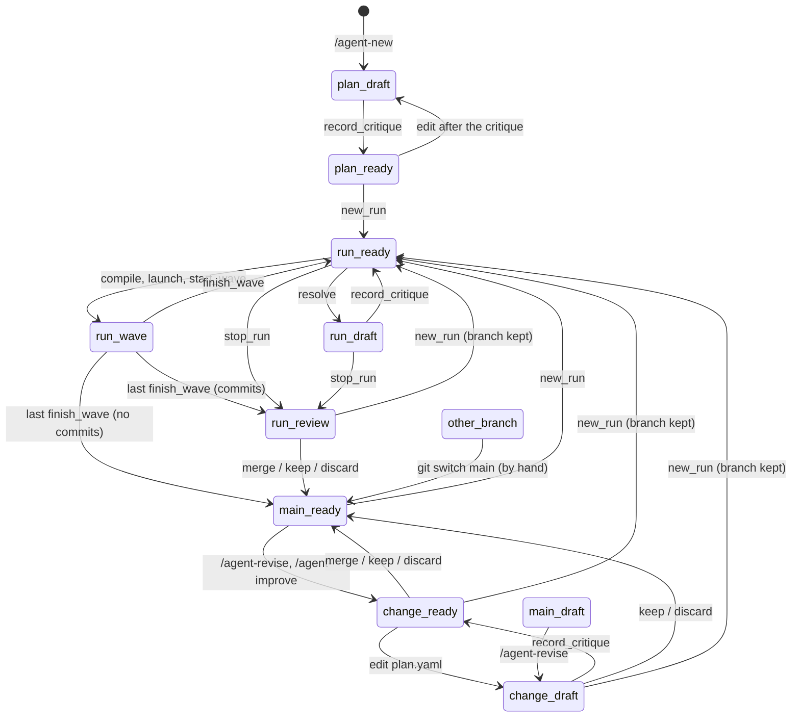

# Agent state machine

This page is for contributors. It lists what an agent can be doing (its **state**) and the moves between states, as the scripts enforce them. If you only run agents, `/agent-status` tells you the state you're in and what you can do next, so you don't need this page.

Why the rules live in one spec, and what went wrong before they did, is in [Design decisions](design.md#the-state-machine-is-a-spec-in-code).

## How it is defined

Everything is in [`agent_state.py`](../.pi/skills/agent/scripts/agent_state.py), written like a [Quint](https://github.com/quint-co/quint) spec in Python:

- **`State`** holds the facts about the agent, read once per call (`read_state`).
- **An action** is one move: a function that runs its **guards**, then returns the states the move can lead to, like Quint's `all { guard, …, state' = … }`. A guard that fails refuses the move with its reason.
- **`require(agent_dir, <action>)`** is the first thing every script calls. Checks on a move's own arguments (which wave, which stage, locked keys, the critic's run id) stay in the scripts.
- **`next`** is in every agent tool's result: the state's name (`name_state`), the moves whose guards pass, and a hint. A refusal and `next` come from the same function, so they can't disagree. `agent_check` returns the same as `state`, and `/agent-status` shows it.
- **`INVARIANTS`** must hold in every state.

[`tests/test_state_machine.py`](../tests/test_state_machine.py) checks it three ways:

- a model check: every state the actions reach from a new agent keeps the invariants, and has a move;
- a walk of the real scripts: a move `next` doesn't list is refused;
- conformance: each real move lands in a state its action predicted.

## One agent's life

The tutorial's agent goes through these states, in this order:

| What happens | State after it |
|---|---|
| `/agent-new` creates the agent and drafts its plan | `plan_draft` |
| the critic's result is recorded (`agent_record_critique`) | `plan_ready` |
| `/agent-run` starts the first run (`agent_start_run`) | `run_ready` |
| the first wave is compiled, launched and recorded as started (`agent_start_wave`) | `run_wave` |
| the wave ends (`agent_finish_wave`) | `run_ready` |
| `discover`'s findings fill in the stages after it (`agent_resolve`) | `run_draft` |
| the critic reviews the resolved stages | `run_ready` |
| the side effect is approved, and the last wave runs and ends | `run_review` |
| you merge the run's branch (`agent_merge`) | `main_ready` |

The agent is now between runs. Here is what `agent_state.py` reports for it (*from emails-to-excel, 2026-10-17*):

```json
{
  "ok": true,
  "state": "main_ready",
  "moves": ["agent_start_run", "/agent-revise", "/agent-improve"],
  "hint": "start a run, or change the plan on a branch",
  "agent": {
    "run": null, "wave": false, "plan_error": null, "main_plan_error": null, "has_run": true,
    "branch": "main", "stuck": false, "branch_name": "main", "off_branch": null, "last_launch": null
  }
}
```

`agent` is the `State` it was named from. The rest of this page is the complete reference: the facts, the states they make, and every move.

## Facts

Each fact is read from one place:

| Fact | Values | Read from |
|---|---|---|
| plan status `P` | `draft`, `needs_answers`, `ready` | `plan.yaml` `status`. A `ready` plan edited after its critique was recorded counts as not ready (`critique.plan_digest`); on a branch, so does one that differs from `main`'s without a critique of it (`plan_validate.check_ready`). |
| active run | none, or one run with status `active` (at most one) | `runs/*/run.yaml` (`run_folders.active_run`) |
| wave running | some stage of the active run is `running` | `run.yaml` `stages`, set by `run_steps.py start-wave` and cleared by `finish-wave` |
| branch `B` | `main`, `run/<id>`, `revise/<date>-<n>`, `improve/<date>-<n>`, or another | git (`agent_repo.branch`) |
| has had a run | yes or no | `agent_repo.has_run` |
| off branch | during a run: whether its branch is checked out, or can be again | `agent_repo.find_off_branch` |

`State` holds them as `run` (the active run's id), `wave`, `plan_error` and `main_plan_error` (why each plan can't run, `None` when it can), `has_run`, `branch` (`main`, `run`, `change` or `other`) and `stuck` (the run's branch isn't checked out and files are left uncommitted).

A few details of how they are read:

- **Has had a run** reads `runs/` first. `runs/` isn't in git, so it also reads `main`'s history: the first run commits there when it has something to commit (`r<rev>: plan for run <id>`), and every merge is `r<rev>: <branch>`. A clone of an agent that ran once, committed nothing then and was never merged still counts as "no run yet".
- **Before the first run** the plan is edited directly on `main`.
- **A branch that is neither `main` nor a run or change branch** counts as `other`: someone checked it out by hand.

## States

A state's name is `<place>_<status>`. The place is the run when one is active, else the branch's kind, else `main` or `plan` for whether the agent has had a run. The status is whether the plan is ready.

| State | Facts | What it means |
|---|---|---|
| `plan_draft` | no run yet, `B` = main, `P` ≠ ready | the plan is a draft, edited directly |
| `plan_ready` | no run yet, `B` = main, `P` = ready | the plan is ready for its first run, and still open to direct edits |
| `main_ready` | runs exist, none active, `B` = main, `P` = ready | can start a run, or a change |
| `main_draft` | runs exist, none active, `B` = main, `P` ≠ ready | `main`'s plan was edited outside the tools; the way out is `/agent-revise` |
| `run_ready` | active run, nothing running, `P` = ready | the next wave is `summary.waves[0]`; its compile may answer with a preflight (decisions, approvals, params, secrets, provisional stages) |
| `run_wave` | active run, a stage `running` | a launch is in pi-subagents; nothing else may launch |
| `run_draft` | active run, nothing running, `P` ≠ ready | `agent_resolve` ran; the critic must be recorded before the next compile |
| `run_review` | no active run, `B` = `run/…` | a run ended (done or stopped) and left a branch to review |
| `change_draft` | no active run, `B` = `revise/…` or `improve/…`, `P` ≠ ready | a change in progress |
| `change_ready` | no active run, `B` = `revise/…` or `improve/…`, `P` = ready | a change just opened (the plan untouched), or the critic passed; review next |
| `other_branch` | no active run, `B` = another branch | someone checked out a branch the agent didn't make; no move is allowed, and the way out is a person's `git switch` |

The states are disjoint: resolving, a critique and a decision all wait for a running wave.



What the diagram leaves out:

- **Moves that stay in their state:** a compile while a preflight waits, `agent_record_decision`, a second `agent_resolve`, the read-only tools, and a critique in `run_review` that makes a stopped run's resolved plan ready, so mergeable.
- **A run that committed nothing** has no branch, so `agent_stop_run` and the last `agent_finish_wave` go straight to `main_ready`.
- **`main_draft`** is reached only when `plan.yaml` on `main` is changed outside the agent (in an editor, or with git), since the agent's guard blocks the edit there. **`other_branch`** is reached only by checking out another branch by hand.
- **During a run, the run's state wins.** Another branch checked out shows as `off_branch` in `next`. A move that commits switches back first when nothing is uncommitted, and refuses otherwise (`stuck`).
- **A `run/…` branch whose plan isn't ready**, from a run stopped after resolving stages, can't be merged until the critic's result for those stages is recorded. Until then it can be kept or discarded.
- **`ends_with` is not a state.** It is recorded at launch and tells the parent what to do after the wave. `approval` and `resolve` are enforced by the compile (side-effect stages need `--approve`; the preflight refuses provisional stages); `review` is not.

## Moves

Each move is allowed only from the states in its row, and only when every guard passes. A guard that fails refuses the move with its reason.

| Move | From | To | Guards | Script |
|---|---|---|---|---|
| `agent_start_run` | `plan_ready`, `main_ready`, `run_review`, `change_draft`, `change_ready` | `run_ready` | no run active; a known branch; `main`'s plan can run | `run_steps.py start-run` |
| `agent_compile_wave` | `run_ready` | `run_ready` | a run between waves; not stuck; waves left; the last launch recorded; `reviewed` after a wave that ended with a review | `run_compile.py` |
| `agent_start_wave` | `run_ready` | `run_wave` | a run between waves; the plan can run; the wave is the next one | `run_steps.py start-wave` |
| `agent_finish_wave` | `run_wave` | `run_ready`; after the last wave `run_review`, or `main_ready` if nothing was committed | a wave running; pi-subagents has finished it and has a record, unless `result` and `status` are passed | `run_steps.py finish-wave` |
| `agent_record_decision` | `run_ready`, `run_draft` | same | a run between waves; a decision stage | `run_steps.py decision` |
| `agent_resolve` | `run_ready`, `run_draft` | `run_draft` | a run between waves; not stuck; no locked key, stage done or side effect changed | `plan_edit.py resolve` |
| `agent_record_critique` | `run_ready`, `run_draft` | `run_ready` if the plan validates, else `run_draft` | no wave running; a known branch; not stuck; a completed critic child with that run id in pi-subagents' records; at most 2 passes each time a run resolves stages | `plan_edit.py critique` |
| | `plan_draft`, `plan_ready`, `change_draft`, `change_ready` | `plan_ready` / `change_ready` if the plan validates, else unchanged | the same, with passes 1 or 2; never on `main` once a run exists | |
| | `run_review` | `run_review` | the same | |
| `agent_stop_run` | `run_ready`, `run_draft` | `run_review`, or `main_ready` if nothing was committed | a run between waves | `run_steps.py stop` |
| `/agent-revise`, `/agent-improve` | `main_ready`, `main_draft`, `change_draft`, `change_ready` | `change_ready` (`change_draft` from `main_draft`; an open change continues) | no run active; a known branch, not a run's; `/agent-improve` also a run the agent has had | `agent_repo.py begin-change` |
| `/agent-revise` | `plan_draft`, `plan_ready` | same (mode `planning`, no branch) | the same | `agent_repo.py begin-change` |
| `agent_merge` | `run_review`, `change_ready` (merge, keep, discard); `change_draft` (keep, discard) | `main_ready` | no run active; a known branch other than `main`; `merge` also a plan that can run | `agent_repo.py merge` |
| edit `plan.yaml` | `plan_draft`, `plan_ready`, `change_draft`, `change_ready` | `plan_draft` / `change_draft`: not ready until the critic is recorded again | no run active; a change branch, or `main` before the first run | the extension's `tool_call` hook |
| edit `gates/`, `scripts/`, `.pi/agents/`, packages | as `plan.yaml`, plus `run_review` and an active run | same | not on `main` once a run exists and none is active | the extension's `tool_call` hook |
| `agent_set_params`, `agent_check`, `agent_sessions` | any | same | none | |

Notes on the moves:

- **`agent_start_run` from a branch** commits the branch's leftovers to it, switches to `main` and keeps the branch for review. Before the first run it commits leftovers on `main`, since that is planning; after it, on the run's branch.
- **`agent_compile_wave`** writes `.compiled/` and commits the plan only when the wave can launch. A plan that can't run comes back as the preflight's `plan_errors`, not as a refusal. A wave launched but not recorded is refused.
- **`agent_finish_wave`** marks the wave's stages done, or puts them back to pending when the wave failed, was blocked or stopped. When pi-subagents is still running it, the refusal says whether its process is gone.
- **`agent_record_critique` in `run_ready`** records the critic again for an unchanged plan, and spends one of the two passes resolving gets. On a change branch, a plan that differs from `main`'s at `main`'s revision gets the next revision.
- **`/agent-revise` and `/agent-improve`** leave the plan as it is, and move leftovers on `main` to the new branch. `/agent-improve` is refused before the first run: there is no run to learn from.
- **`agent_merge`** makes one commit on `main`. A conflict with a `main` that moved leaves the branch checked out.

## Allowed outside the table

- **Direct edits to `gates/`, `scripts/` and `.pi/agents/` in `run_review`.** They are committed on the branch at the review, so they reach `main` only through it.
- **Commits on `main` before the first run.** That is planning, and `agent_start_run` commits it.
- **Changes made outside the extension's guard**, in the user's editor or by a shell command the guard doesn't parse, are not refused. Once a run exists, `agent_start_run` and `begin-change` commit them on the new branch, so they still reach `main` only by a reviewed merge.

## Limits

- **pi-subagents' records are internal**, not an API (`scriptDigest`, `workflowChildren`, the missions store). If their shape changes, the launched-twice check and the mission lookup find nothing (they fail open), and the critic check fails closed (every critique refused), which the first live planning session would show. The tests use fake records of the current shape.
- **The model check explores the spec, not the scripts.** Conformance ties the two together, but only for the moves the walk tries. What a person does by hand is modelled as three actions in the test: edit the plan, check out another branch, leave a file uncommitted.
- **The walk explores each configuration once** (the value of every condition), from the first history that reaches it. A bug that needs a particular history to show, such as resolving twice in one run, can still slip past it.

After every move, the walk checks:

- at most one run is active;
- a wave runs only in an active run, one at a time, and nothing launches while it runs;
- only a ready plan launches, and a run starts only from a ready plan on `main`;
- `main` changes only by a merge, or by planning before the first run.

Not in scope: blocking tools in the extension by state (the scripts refuse the unsafe moves), and anything about the quality of a stage's output.
