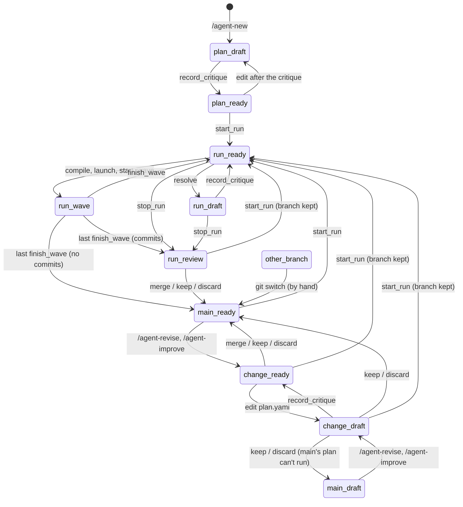

# Agent state machine

This page is for contributors. It lists what an agent can be doing (its **state**) and the moves between states, as the scripts enforce them. If you only run agents, `/agent-status` tells you the state you're in and what you can do next, so you don't need this page.

Why the rules live in one spec, and what went wrong before they did, is in [Design decisions](design.md#the-state-machine-is-a-spec-in-code).

## How it is defined

Everything is in [`agent_state.py`](../.pi/skills/agent/scripts/agent_state.py), written like a [Quint](https://github.com/quint-co/quint) spec in Python. It has four parts.

**`State`: where the agent stands.** A handful of facts, such as whether a run is active, whether a wave is running, and whether the plan can run. The state is never stored: there is no file that says which state the agent is in. Every script call works it out again (`read_state`) from the agent's files and git: `run.yaml`, the plan and its critique, `main`'s plan, the branch checked out. So it can't drift from the files, even when a person edits the plan, switches branches by hand, or a process dies halfway through a move. [The state](#the-state) lists the facts and where each is read from.

**`Actions`: the moves.** Each move (start a run, compile a wave, merge a branch, …) is one function. It does two things:

1. It runs its **guards**: the conditions under which the move is allowed. A guard that fails raises `Refused` with the reason, which is what the user sees.
2. If every guard passes, it returns the state or states the move can lead to. This is a prediction, not a change: the action never writes anything. The tests use it (see [Tests](#tests)).

For example, starting a run:

```python
def start_run(a):
    guard_no_run(a)                    # no other run is active
    guard_known_branch(a)              # the branch checked out is one the agent made
    guard(not a.main_plan_error, f"the plan on main, which a run starts from, can't run: {a.main_plan_error}")
    started = State(run="new", plan_error=None, main_plan_error=None, has_run=True)
    return committed([started]) if a.has_run else [started]
```

`MOVES` maps each tool or command name (`agent_start_run`, `/agent-revise`, …) to its action.

**`require(agent_dir, <action>)`: how the scripts obey the spec.** An action only describes a move; nothing runs it when a script does the move for real. So every script that makes a move calls `require` first, for example `require(agent_dir, start_run)` in `run_steps.py start-run`. It reads the real `State` from disk and runs the action's guards. If one fails, the script stops with that reason, before it has changed anything. The guards only look at the agent's state. Whatever depends on the move's own arguments is checked by the script itself, after `require` passes. For example, that the wave it is given is the next one, that the stage it records a decision for is a decision stage, or that a critic's run id names a completed critic.

**`next_of`: what can happen now.** `next_of(a)` tries every action's guards against a state and returns the state's name (`name_state`, such as `run_ready`), the moves whose guards pass, and a hint for the model; `read_next(agent_dir)` does it for the state read from disk (`read_state`). Results carry it under the key `next`: the result of every tool that makes or records a move includes it. The same goes for `agent_set_params`, `agent_add_package` and every refusal from `require`. Those scripts call `utils.report_state`, and `utils.emit` then adds `next` to whatever they print. Since `next_of` runs the same guards as `require`, a move listed in `next` is never refused, and a refused move is never listed. `agent_check` returns the same object as `state`, and `/agent-status` shows it. `agent_sessions` only reads session files and returns no `next`.

**`INVARIANTS`: what is always true.** Statements that must hold in every state, such as "a wave runs only in an active run". The tests check them in every state the actions can reach. Rules about a move ("never launch from a plan that can't run") are not invariants; they are that move's guards.

A few words the page relies on:

- A **wave** is a group of stages launched together. Running one takes three steps: `agent_compile_wave` writes the wave and commits the plan; the `subagent` tool **launches** it in pi-subagents; `agent_start_wave` records that launch in `run.yaml`. When pi-subagents reports the end, `agent_finish_wave` records it.
- The **critic** is a separate agent that reviews the plan; `agent_record_critique` records its result and ties it to the plan by a digest.
- A **review** of a branch ends in one of three actions, all `agent_merge`: **merge** squashes the branch into one commit on `main` and deletes it; **keep** switches back to `main` and leaves the branch for later; **discard** switches back and deletes it.
- **Once the agent has had a run** (`has_run`) is different from **during a run** (`run`, a run is active): the first is permanent, the second lasts until the run ends.

The rest of this page follows that order: the facts `State` holds, the states named from them, an example agent's life, every move, and how the tests check it all.

## The state

`State` has seven fields that the moves depend on, and three more that are there only for people. Each is read from one place:

| Field | What it means | Read from |
| --- | --- | --- |
| `run` | the active run's id, or none. At most one run is active. | `runs/*/run.yaml` with `status: active` (`run_folders.active_run`) |
| `wave` | a wave of that run has been launched and not yet recorded as finished | `run.yaml` `stages`: `run_steps.py start-wave` sets them running, `finish-wave` clears them |
| `plan_error` | why the checked-out `plan.yaml` can't run; none when it can | `plan_validate.check_ready`: the plan is invalid, its `status` isn't `ready`, or it was edited after its critique was recorded (`critique.plan_digest`). On a branch, a plan that differs from `main`'s without a critique of it can't run either. |
| `main_plan_error` | the same for `main`'s plan, which every new run starts from | the same check, on `main` |
| `has_run` | the agent has had a run | `agent_repo.has_run` (see below) |
| `branch` | the kind of branch checked out: `main`, `run` (`run/<id>`), `change` (`revise/…` or `improve/…`), or `other` | git (`agent_repo.branch`) |
| `stuck` | during a run and between waves, the run's branch isn't checked out and files are left uncommitted, so a script can't switch back. The run's branch is `main` until the run's first commit, `run/<id>` after it. While a wave runs it is always false: nothing may refuse recording the wave. | `agent_repo.find_off_branch` |
| `branch_name`, `off_branch`, `last_launch` | the branch's full name; what to do when you're off the run's branch; the latest launch | for people only; no move depends on them |

A few details of how they are read:

- **`has_run`** reads `runs/` first. `runs/` isn't in git, so a clone has none; `has_run` then looks in `main`'s history for the commit messages only runs and merges write. The first run's commit is `r<rev>: plan for run <id>` when it has something to commit, and every merge is `r<rev>: <branch>`, where `<rev>` is the plan's `revision`. A clone of an agent that ran once, committed nothing and was never merged still counts as "no run yet", so it lands in `plan_…` with `main` open to direct edits.
- **Before the first run** the plan is edited directly on `main`; that is planning. After it, `main` changes only by a reviewed merge.
- **`other`** is a branch that is neither `main` nor a run or change branch: someone checked it out by hand.

## The states

A state's name is `<place>_<status>`. It is made from the fields in this order, and the first rule that applies wins:

1. **A run is active.** The place is `run`: `run_wave` while a wave runs, else `run_ready`, or `run_draft` when the plan can't run.
2. **Else, `main` is checked out.** The place is `plan` before the first run and `main` after it; the status is `ready` or `draft`, from `plan_error`.
3. **Else, by the branch.** A `run/…` branch is `run_review`; a `revise/…` or `improve/…` branch is `change_ready` or `change_draft`; any other branch is `other_branch`.

So during a run the run's state wins, whatever branch is checked out. Being off the run's branch shows as `off_branch` in `next`.

| State | What it means |
| --- | --- |
| `plan_draft` | planning: the plan is a draft, edited directly on `main` |
| `plan_ready` | the plan is ready for its first run, and still open to direct edits |
| `main_ready` | between runs: you can start a run, or a change |
| `main_draft` | `main`'s plan was edited outside the tools; the way out is a change (`/agent-revise` or `/agent-improve`), or undoing the edit |
| `run_ready` | a run between waves: compile the next one. Its compile may answer with a preflight that asks for decisions, approvals, param values or secrets, or for provisional stages to be resolved. |
| `run_wave` | a launch is in pi-subagents; nothing else moves until it's recorded |
| `run_draft` | a run between waves whose plan can't run: almost always because it resolved stages (`agent_resolve`) and the critic must be recorded before the next launch |
| `run_review` | a run ended (done or stopped) and left its branch to review |
| `change_draft` | a revise or improve in progress |
| `change_ready` | a change just opened (the plan untouched), or the critic passed: review it next |
| `other_branch` | someone checked out a branch the agent didn't make; no move that changes the agent is allowed until a person runs `git switch` |

Every combination of fields gets exactly one name, since the rules above are tried in order. That only works because a running wave blocks the moves that would change the plan or the run (resolving, a critique, a decision, a stop): `run_wave` never has to say whether the plan is ready.

## One agent's life

The tutorial's agent goes through these states, in this order:

| What happens | State after it |
| --- | --- |
| `/agent-new` creates the agent and drafts its plan | `plan_draft` |
| the critic's result is recorded (`agent_record_critique`) | `plan_ready` |
| `/agent-run` starts the first run (`agent_start_run`) | `run_ready` |
| the first wave is compiled, launched and recorded as started (`agent_start_wave`) | `run_wave` |
| the wave ends (`agent_finish_wave`) | `run_ready` |
| `discover`'s findings fill in the stages after it (`agent_resolve`) | `run_draft` |
| the critic reviews the resolved stages | `run_ready` |
| the side effect is approved, and the last wave launches | `run_wave` |
| the last wave ends; the run leaves a branch | `run_review` |
| you merge the run's branch (`agent_merge`) | `main_ready` |

The agent is now between runs. Here is what `agent_state.py` reports for it (*from emails-to-excel, 2026-10-17*):

```json
{
  "ok": true,
  "state": "main_ready",
  "moves": ["agent_start_run", "/agent-revise", "/agent-improve"],
  "hint": "start a run, or change the plan on a branch",
  "agent": {
    "run": null, "wave": false, "plan_error": null, "main_plan_error": null, "has_run": true,
    "branch": "main", "stuck": false, "branch_name": "main", "off_branch": null, "last_launch": null
  }
}
```

`agent` is the `State` it was named from. The diagram shows every state and the moves between them:



What the diagram leaves out:

- **Moves that stay in their state:** a compile that answers with a preflight, `agent_record_decision`, a second `agent_resolve`, `agent_check` and the other tools that change nothing, and a critique in `run_review`. That critique doesn't change the state's name, but it makes the stopped run's resolved plan ready, so the branch can then be merged.
- **`other_branch` leads wherever you switch to:** `main_ready` (or `plan_…` before the first run), or a run's or change's state for one of the agent's branches.
- **A run that committed nothing** has no branch, so `agent_stop_run` and the last `agent_finish_wave` go straight to `main_ready`.
- **`main_draft`** is reached when `plan.yaml` on `main` is changed outside the agent (in an editor, or with git), since the extension's hook blocks the agent's own edit there, or when a keep or discard returns to a `main` whose plan can't run. Undoing the edit (`git restore plan.yaml`) also leads back to `main_ready`. **`other_branch`** is reached only by checking out another branch by hand.
- **A `run/…` branch whose plan isn't ready**, from a run stopped after resolving stages, can't be merged until the critic's result for those stages is recorded. Until then it can be kept or discarded.

## Moves

Each move is allowed only from the states in its row, and only when every guard passes. The guards here are the spec's; the checks each script makes on its own arguments are listed in the notes after the table. A **known branch** is any but `other`.

| Move | From | Guards | To |
| --- | --- | --- | --- |
| `agent_start_run` | `plan_ready`, `main_ready`, `run_review`, `change_draft`, `change_ready` | no run active; a known branch; `main`'s plan can run | `run_ready`. The run starts on `main` (an open branch is kept for review); its first commit creates `run/<id>` and checks it out. |
| `agent_compile_wave` | `run_ready`, `run_draft` | a run between waves; not `stuck` | the same state. When the plan can't run, the wave has provisional stages, or a side effect isn't approved, the answer is a preflight (`plan_errors`, what to resolve, `approvals_needed`): no `.compiled/<wave>.js` is written and nothing is committed, so there is no wave for the `subagent` tool to launch. |
| `agent_start_wave` | `run_ready` | a run between waves; the plan can run | `run_wave` |
| `agent_finish_wave` | `run_wave` | a wave running | `run_ready`; after the run's last wave ends done, the run ends: `run_review`, or `main_ready` if the run committed nothing (it has no branch) |
| `agent_record_decision` | `run_ready`, `run_draft` | a run between waves | the same state |
| `agent_resolve` | `run_ready`, `run_draft` | a run between waves; not `stuck` | `run_draft` |
| `agent_record_critique` | every state except `run_wave`, `main_…` and `other_branch` | no wave running; a known branch; outside a run, not on `main` once the agent has had a run; not `stuck` | `plan_ready`, `run_ready` or `change_ready` if the plan validates, else unchanged; `run_review` stays `run_review` |
| `agent_stop_run` | `run_ready`, `run_draft` | a run between waves | `run_review`, or `main_ready` if nothing was committed |
| `agent_merge` | `run_review`, `change_ready`, `change_draft` | no run active; a branch other than `main`; for `merge`, a plan that can run | `main_ready`, or `main_draft` if a keep or discard leaves `main`'s plan unable to run |
| `/agent-revise` | `plan_…`, `main_…`, `change_…` | no run active; a known branch; not a `run/…` branch awaiting review | from `main_ready`, `change_ready`; from `main_draft`, `change_draft`. In `plan_…` and `change_…` the state stays: before the first run it edits the plan directly on `main`, as planning does, and on an open change it continues that change. |
| `/agent-improve` | `main_…`, `change_…` | as `/agent-revise`, and the agent has had a run | as `/agent-revise` |
| edit `plan.yaml` | `plan_…`, `change_…` | no run active; a change branch, or `main` before the first run | `…_draft` until the critic is recorded again |

The scripts' own checks:

- **`agent_finish_wave`** needs pi-subagents to have finished the wave and to have a record of it, unless a `result` and `status` are passed in. When pi-subagents is still running it, the refusal says whether its process is gone.
- **`agent_record_critique`** needs a completed critic child with that run id in pi-subagents' records, and allows two passes each time a run resolves stages (passes 1 or 2 while planning or changing).
- **`agent_resolve`** refuses locked keys, stages that already ran, and changes to a side effect.
- **`agent_compile_wave`** refuses a wave that was launched but never recorded, and needs its `--reviewed` flag after a wave that ended with a review (the user said go on).

What each move does besides changing the state:

- **`agent_start_run` from a branch** commits the branch's leftovers to it, switches to `main` and keeps the branch for review. Before the first run it commits leftovers on `main`, since that is planning; after it, on the run's branch.
- **`agent_compile_wave`** writes `.compiled/` and commits the plan only when the wave can launch.
- **`agent_finish_wave`** marks the wave's stages done, or puts them back to pending when the wave failed, was blocked or was stopped, so a relaunch runs them again.
- **`agent_record_critique` in `run_ready`** records the critic again for an unchanged plan, and spends one of the two passes that resolving gets. On a change branch, a plan that differs from `main`'s at `main`'s revision gets the next revision.
- **`/agent-revise` and `/agent-improve`** leave the plan as it is, and move leftovers on `main` to the new branch.
- **`agent_merge`** makes one commit on `main`. A conflict with a `main` that moved leaves the branch checked out, to resolve by hand or discard.
- **A run's first commit** is usually `agent_start_run`'s own (`r<rev>: plan for run <id>`), when there is anything uncommitted. In the agent's first run it lands on `main`, since that is still planning. In every later run it creates `run/<id>` from `main` and checks it out; when `agent_start_run` had nothing to commit, the first move that commits (a compile, a resolve, a critique) does that instead.
- **Between the launch and `agent_start_wave`** the state still reads `run_ready`. The agent records the launch right after the `subagent` call; if a session ends in between, the next compile finds the launch in pi-subagents' records and refuses to launch it twice.
- **A move that commits during a run** first switches back to the run's branch. When files are left uncommitted it can't (`stuck`), so the move is refused. `agent_finish_wave` and `agent_stop_run` are never refused for this: they record the wave or the stop as usual, skip only the commit, and leave the other branch checked out.

## Invariants

The spec's `INVARIANTS` hold in every state:

- a wave runs only in an active run;
- an active run is one the agent has had;
- only a run between waves can be `stuck`;
- on `main`, `main`'s plan is the plan (`main_plan_error` = `plan_error`).

Properties of moves, such as "never launch from a plan that can't run", aren't invariants: they are the actions' guards.

The walk (see [Tests](#tests)) also checks these on the real files after every move. They describe the files across a move, not one `State`, so they can't be invariants of the spec:

- at most one run is active, with at most one wave running;
- nothing launches while a wave runs, and only a ready plan launches;
- a run starts only from a ready plan on `main`;
- `main` changes only by a merge, or by planning before the first run.

## Tests

[`tests/test_state_machine.py`](../tests/test_state_machine.py) checks the spec three ways:

- **A model check** explores every state the actions can reach from a new agent, and checks that each keeps the invariants and has a way out.
- **A walk** runs the real scripts from every configuration it reaches, including what a person does by hand (edit the plan, switch branches, leave files uncommitted). A move that `next` doesn't list must be refused and change nothing.
- **Conformance** checks that each real move lands in a state its action predicted.

## Outside the spec

- **Hand edits to `gates/`, `scripts/`, `.pi/agents/` and packages** are allowed wherever the plan may be edited, and also in `run_review` and during a run, but never on `main` once the agent has had a run. The extension's `tool_call` hook enforces this, and the "edit `plan.yaml`" row of the moves table. During a run, the plan itself changes only through `agent_resolve` and `agent_record_critique`. Edits in `run_review` are committed on the branch at the review, so they reach `main` only through it.
- **Commits on `main` before the first run** are planning, and `agent_start_run` commits what is left.
- **Changes the hook can't see**, made in your editor or by a shell command it doesn't parse, aren't refused. Once a run exists, `agent_start_run` and a new change commit them on the new branch, so they still reach `main` only through a review.
- **`ends_with` is not a state.** It is recorded at launch and tells the agent what follows the wave: `resolve`, `review`, `approval` or `none`. All three that ask for something are enforced by `agent_compile_wave`, on the next wave: `resolve` by its preflight, which lists the provisional stages to resolve and launches nothing; `review` by its `--reviewed` flag; `approval` by its `--approve` flag: without it the compile answers with `approvals_needed` and compiles nothing.
- **`agent_set_params`, `agent_check` and `agent_sessions`** are allowed in any state and leave it as it is (`agent_set_params` writes only `.env`, which no fact reads).

## Limits

- **pi-subagents' records are internal**, not an API (`scriptDigest`, `workflowChildren`, the missions store); only `pi_records.py` reads them, so a change in their shape is fixed there. If their shape changes, the launched-twice check and the mission lookup find nothing and let the move through (they fail open), while the critic check refuses every critique (it fails closed), which the first live planning session would show. The tests use fake records of today's shape.
- **The model check explores the spec, not the scripts.** Conformance ties the two together, but only for the moves the walk tries.
- **The walk explores each configuration once** (the value of every field), from the first history that reaches it. A bug that needs a particular history to show, such as resolving twice in one run, can still slip past it.
- **Not in scope:** blocking tools in the extension by state (the scripts refuse the unsafe moves), and anything about the quality of a stage's output.
